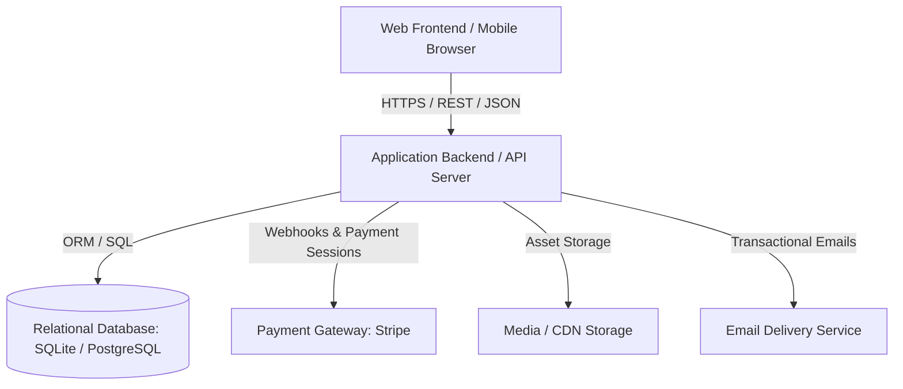
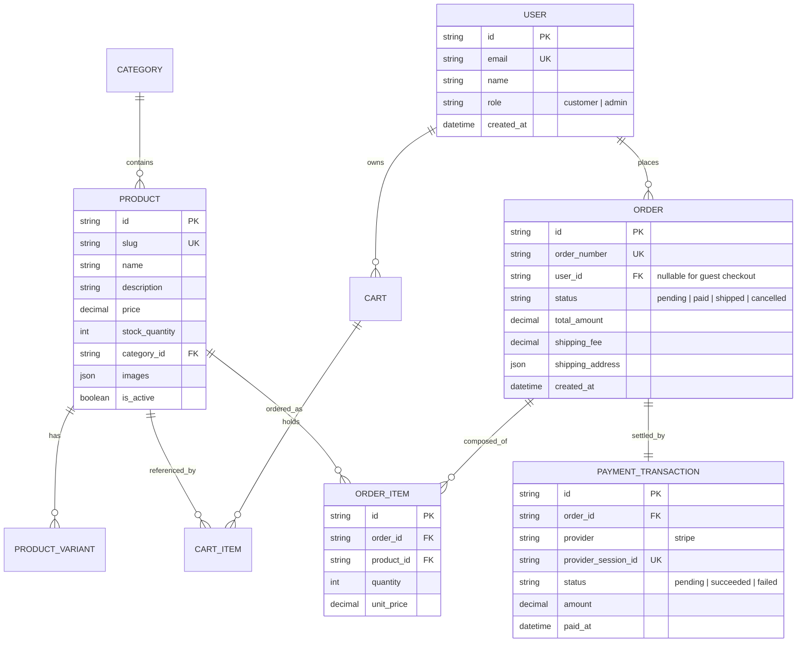

# System Architecture & Data Modeling

This skill defines the technical blueprint, data schemas, and integration contracts for **WuazeShop** before writing code.

---

## 1. High-Level Architecture Topology



---

## 2. Relational Data Model (Schema Blueprint)

Define the primary entities and relationships before running database migrations:



---

## 3. API Contract Specifications (Data Transfer Objects)

Every endpoint must have its request schema and response format documented before implementation.

### Example Contract: Create Order / Checkout Session
- **Endpoint**: `POST /api/checkout/create-session`
- **Headers**: `Content-Type: application/json`
- **Request Body**:
  ```typescript
  interface CreateCheckoutSessionRequest {
    items: Array<{
      productId: string;
      quantity: number;
    }>;
    customerEmail: string;
    shippingAddress: {
      fullName: string;
      street: string;
      city: string;
      postalCode: string;
      country: string;
    };
  }
  ```
- **Response (200 OK)**:
  ```typescript
  interface CreateCheckoutSessionResponse {
    success: true;
    data: {
      orderId: string;
      checkoutUrl: string;
      expiresAt: string;
    };
  }
  ```

---

## 4. Architectural Decision Records (ADR) Checklist

Before starting implementation, document any trade-offs:
- [ ] Database Choice: Embedded (SQLite) for rapid MVP vs PostgreSQL for scalable production.
- [ ] State Management: Server-side sessions vs Client-side persistent cart with backend sync.
- [ ] Asset Strategy: Local upload storage vs Cloudinary / S3 bucket.
- [ ] Fallback & Circuit Breaking: How does the application behave if payment or email services timeout?
